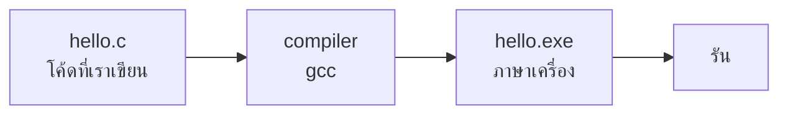

# 0.1 คอมพิวเตอร์อ่านโค้ดเรายังไง

## คอมพิวเตอร์ไม่รู้จักภาษา C

ข้างในคอมพิวเตอร์มีแค่สัญญาณไฟฟ้าเปิดกับปิด เขียนแทนด้วย `1` กับ `0` คำสั่งที่ CPU ทำได้จริงจึงเป็นตัวเลขฐานสองยาวๆ เรียกว่า **ภาษาเครื่อง (machine code)**

```text
01010101 01001000 10001001 11100101 ...
```

คนเขียนแบบนี้ไม่ไหว เราเลยเขียนเป็นภาษาที่คนอ่านออก เช่นภาษา C

```c
printf("Hello, World!\n");
```

แล้วให้โปรแกรมอีกตัวช่วย **แปล** เป็นภาษาเครื่อง ตัวแปลมีสองแบบใหญ่ๆ

## ตัวแปลแบบที่ 1 compiler

compiler อ่านโค้ด **ทั้งไฟล์** แปลเป็นภาษาเครื่องให้เสร็จก่อน ได้ออกมาเป็นไฟล์โปรแกรม (บน Windows คือไฟล์ `.exe`) จากนั้นค่อยรันไฟล์นั้น

> เหมือนจ้างคนแปลหนังสือทั้งเล่มจนเสร็จ แล้วเราค่อยอ่านฉบับแปล อ่านซ้ำกี่รอบก็ไม่ต้องแปลใหม่



ภาษาที่ใช้ compiler เช่น **C** และ **C++**

## ตัวแปลแบบที่ 2 interpreter

interpreter อ่านโค้ด **ทีละบรรทัด** แปลแล้วทำทันที ไม่มีไฟล์ `.exe` เกิดขึ้น

> เหมือนมีล่ามยืนข้างๆ คอยแปลให้ฟังทีละประโยค เริ่มได้ทันที แต่ทุกครั้งที่ฟังใหม่ ล่ามต้องแปลใหม่ทุกประโยค

ภาษาที่ใช้ interpreter เช่น **Python**

## ต่างกันยังไง

| | compiler (C, C++) | interpreter (Python) |
|---|---|---|
| เริ่มรัน | ต้องแปลทั้งไฟล์ก่อน | รันได้ทันที |
| ความเร็วตอนรัน | เร็วมาก | ช้ากว่าหลายสิบเท่า |
| ถ้าพิมพ์ผิด | บอก error ก่อนรัน ยังไม่ได้รันสักบรรทัด | รันไปจนถึงบรรทัดที่ผิดแล้วค่อยหยุด |
| สิ่งที่ได้ | ไฟล์ `.exe` เอาไปรันที่ไหนก็ได้ | ต้องมี Python ในเครื่องที่จะรัน |

### เร็วกว่ากันแค่ไหน

ลองให้ทั้งสองภาษาวนลูป 100 ล้านรอบแบบเดียวกัน บนโน้ตบุ๊กที่ใช้เขียนเอกสารนี้

| ภาษา | เวลา |
|---|---|
| C | ประมาณ 0.13 วินาที |
| Python | ประมาณ 5.2 วินาที |

C เร็วกว่าราว **40 เท่า** ตัวเลขบนเครื่องน้องจะไม่เท่านี้ แต่ห่างกันระดับนี้เหมือนกัน

## ทำไมค่ายนี้ใช้ภาษา C

1. **โจทย์แข่งขันจำกัดเวลา** โปรแกรมต้องตอบให้ทันภายในเวลาที่โจทย์กำหนด ซึ่งมักแค่ 1 วินาที ภาษาที่รันเร็วได้เปรียบมาก
2. **เห็นว่าคอมพิวเตอร์ทำงานจริงยังไง** C ไม่ซ่อนอะไรไว้มาก น้องจะเข้าใจเรื่องหน่วยความจำ ชนิดข้อมูล และขนาดของตัวเลข ซึ่งเป็นพื้นฐานของทุกภาษา
3. **เป็นฐานของ C++** C++ ต่อยอดมาจาก C เกือบทั้งหมด เรียน C ให้แน่นก่อน ตอนขึ้น C++ จะเหมือนได้เครื่องมือเพิ่ม ไม่ใช่เริ่มใหม่

!!! note "Python ไม่ได้แย่"
    Python เขียนสั้น อ่านง่าย เหมาะกับงานวิเคราะห์ข้อมูล AI และงานอัตโนมัติ แต่ละภาษาเหมาะกับงานคนละแบบ สำหรับการแข่งที่วัดความเร็ว C และ C++ ตอบโจทย์กว่า

## C กับ C++ ใช้ตัวแปลตัวไหน

ทั้งสองภาษาใช้ชุด compiler เดียวกันชื่อ **GCC** ซึ่งมากับ Code::Blocks ที่จะติดตั้งในหน้าถัดไป

| ภาษา | นามสกุลไฟล์ | ตัวแปล |
|---|---|---|
| C | `.c` | `gcc` |
| C++ | `.cpp` | `g++` |

Code::Blocks ดูนามสกุลไฟล์แล้วเลือกตัวแปลให้เอง น้องมีหน้าที่อย่างเดียวคือ **ตั้งชื่อไฟล์ให้ลงท้ายถูก** ช่วงนี้เราเขียน C ไฟล์ทุกไฟล์ต้องลงท้ายด้วย `.c`
